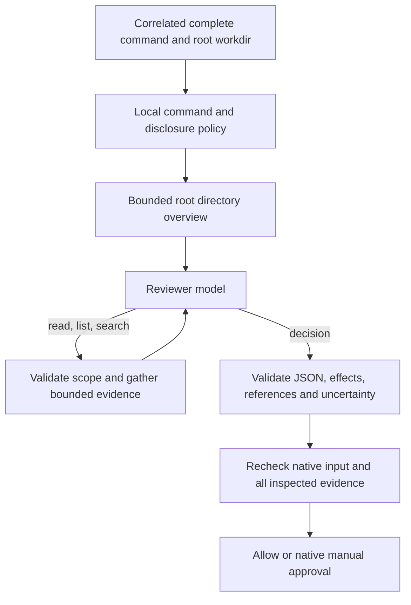

# Generic stateful project review

Stateful mode lets the reviewer investigate a complete shell command using bounded
project evidence, regardless of build tool or programming language. There are no
Make/Bash parsers, command allowlists, phony requirements or trusted recipe steps.
The model judges execution semantics. Local code enforces source correlation,
configured disclosure, observable command restrictions, budgets, response validation
and evidence freshness. It does not prove arbitrary programs safe or isolate them.

Stateless inspection remains the default. These options require version 0.2.0
or later (or a local build). Merge this into plugin options alongside `model`:

```json
{
  "mode": "balanced",
  "systemPrompt": "Investigate relevant build files and imported scripts. Ask when dependencies or effects are unclear.",
  "review": {
    "strategy": "stateful",
    "maxModelCalls": 4,
    "allowShellSyntax": false,
    "alwaysAsk": [],
    "forbiddenEffects": [
      "network",
      "privilege",
      "destructive",
      "outside_project",
      "unknown"
    ],
    "project": {
      "allowFileContents": true,
      "allowedPaths": ["."],
      "excludedPaths": ["private", "artifacts"],
      "maxFileBytes": 16384,
      "maxTotalBytes": 65536,
      "maxFiles": 16,
      "maxDirectoryEntries": 128
    }
  }
}
```

`allowFileContents: true` explicitly permits disclosure of requested file contents
within `allowedPaths` to the configured provider. `.` covers the project, subject
to exclusions and limits. Narrow it to specific files or directory prefixes if
needed. Paths are literal prefixes, not globs. All supplied project content is
untrusted evidence, including README files and embedded agent instructions.

## Review loop

The plugin starts with a scoped root directory listing. The reviewer can request
one full-file read, directory listing, or recursive literal-text search per model
call, then return a structured final decision. Each call uses the existing native
stateless text API with the accumulated evidence; there is no provider agent,
execution tool, MCP server or provider-side persistent conversation.



Ninja, CMake, Meson, Bazel, Python, Ruby, Node and unfamiliar executables follow
this same path. The model must request relevant evidence and judge dependencies;
there is no executable-name inference that a command is safe. Dynamic imports,
generated code, environment-dependent behavior, package dependencies or missing
files may prevent a sufficient review and require `ask`.

Every allow must reference at least one successful full-file read from the current
request. Listings, search snippets and previous findings alone cannot authorize
execution. This is a minimum evidence requirement, not proof that the model chose
all relevant files. A malicious or mistaken model can still approve a harmful command.

## Local controls and budgets

| Option                               | Default     | Contract                                                        |
| ------------------------------------ | ----------- | --------------------------------------------------------------- |
| `review.strategy`                    | `stateless` | `stateless` inspection or opt-in `stateful` review              |
| `review.maxModelCalls`               | `4`         | Total model calls per evaluation, 1–8, including final decision |
| `review.allowShellSyntax`            | `false`     | Permit raw shell syntax to reach model review                   |
| `review.alwaysAsk`                   | `[]`        | Case-sensitive literal command substrings that force ask        |
| `review.forbiddenEffects`            | see example | Reject model-declared effects in this list                      |
| `review.project.allowFileContents`   | `false`     | Required explicit disclosure consent                            |
| `review.project.allowedPaths`        | `["."]`     | Project-relative files/directory prefixes available as evidence |
| `review.project.excludedPaths`       | `[]`        | Additional prefixes excluded from evidence                      |
| `review.project.maxFileBytes`        | `16384`     | Per-file limit, 1–65536 bytes                                   |
| `review.project.maxTotalBytes`       | `65536`     | Aggregate unique file bytes, 1–262144                           |
| `review.project.maxFiles`            | `16`        | Unique files and, separately, directories, each limited to 1–32 |
| `review.project.maxDirectoryEntries` | `128`       | Total entries examined across unique directories, 1–512         |

Choosing `stateful` applies this protocol to every eligible shell request, including
inspection commands; `stateless` retains the original inspection-only behavior.

Lists accept up to 32 entries of at most 300 characters. Paths must use ordinary
ASCII letters/numbers, spaces, underscores, dots, hyphens or slashes, without
absolute paths, empty components or `.`/`..` components (except root `.`).
Excluded scopes cannot be widened by the model. Navigation may list ancestors of
allowed prefixes, but exposes only entries leading to permitted paths.

Built-in exclusions cover `.git`, `node_modules`, `.ssh`, `.aws`, `.gnupg`,
`.codex`, `.agents`, common credential filenames, and sensitive-name matches.
Symlinked paths, special files, invalid UTF-8, binary/control content and sensitive
content matches are unavailable. Secret detection is heuristic, not a guarantee;
do not grant disclosure access to confidential project areas.

Reads return whole files or an explicit unavailable result, never truncated text.
Search is literal, recursive to depth 16, and examines only permitted text files.
It returns at most 32 matching lines of at most 300 characters; overruns are
unavailable, not silently truncated. Directory listings and searches explicitly
state that their scope is permitted paths only. Excluded entries are not disclosed;
all encountered entries still count against traversal limits.

The default shell tripwire rejects backslashes, newlines, `;`, `&`, `|`, backticks,
`$`, redirection characters, parentheses and braces anywhere in the raw command.
This intentionally over-rejects some quoted arguments. It is not a shell parser or
proof against indirect execution. `allowShellSyntax: true` delegates those commands
to model review too. Commands are bounded to 8192 characters; command plus scanner
fragments to 16384 characters and 32 scanner fragments at most. An empty
resource list asks. Sensitive-data tripwires run before any command disclosure.
`alwaysAsk` also applies to eligible inspection commands in stateful mode.

The working directory must remain the project root in this version. Missing
native source correlation asks. Scanner fragments can be multiple or different
from the complete command; the complete native input is always supplied and
rechecked. The model never reconstructs a command from scanner fragments.

`timeoutMs` covers context, overview, every evidence operation, model call and
final recheck together. Eight unsettled reviews are admitted per plugin instance.
Same-session project reviews overlap only by returning `stateful_busy`; no queue
is added. A provider call or filesystem operation that ignores cancellation can
retain capacity until it settles. No further model calls start after cancellation.

## Protocol and approval

Evidence requests have exactly one of these shapes:

```json
{"action":"read","path":"build.ninja"}
{"action":"list","path":"src"}
{"action":"search","path":"src","query":"import helper"}
```

The final response has this shape:

```json
{
  "action": "decide",
  "decision": "allow",
  "riskLevel": "low",
  "reasonCode": "understood_operation",
  "confidence": 0.99,
  "uncertain": false,
  "evidence": ["e2"],
  "effects": ["workspace_read", "process_execution"]
}
```

Effects are `workspace_read`, `workspace_write`, `process_execution`, `network`,
`privilege`, `destructive`, `outside_project`, and `unknown`. Reason codes are
`understood_operation`, `incomplete_evidence`, `uncertain_effects`,
`suspicious_instruction`, and `restricted_effect`.

Allow requires low risk, `uncertain: false`, `understood_operation`, no forbidden
effects, no `unknown` effect, valid evidence references including a current full
read, and confidence at least 0.98/0.90/0.80 for strict/balanced/permissive modes.
These are declared model judgments. A false declaration can evade semantic
restrictions; `forbiddenEffects` does not enforce filesystem or network isolation.
Use native hard denies and actual host isolation where required.

Duplicate fields (including escaped names), extra fields, nested objects, unknown
actions/effects, invalid paths and malformed JSON ask. Replies are bounded to 4096
characters. Repeating an evidence request asks with `evidence_no_progress`.
Unavailable requested evidence always prevents allow, even if a later response
ignores it. No decision within the call budget produces `review_budget`.

All inspected file contents and visible directory inventories are rechecked before
accepting a decision. File or inventory changes produce `project_changed`. Input,
workdir or resource changes produce `input_changed` or missing-source fallback.
The recheck has its own instance of the same aggregate inspection limits, so total
filesystem work is bounded to an inspection pass and a verification pass.

## Session state and audit

Memory retains up to eight structured findings per session: effect/risk/reason
categories, a local complete-command hash, and evidence paths/fingerprints. Up to 32 sessions are retained, expiring
five minutes from their first retained finding, checked on subsequent reviews.
Provider prose, command history and file contents are not stored between reviews.
Sessions are scoped to one project/plugin instance and its model/configuration.

Previous file paths can guide discovery, but prior findings are withheld until
the complete-command hash matches and all referenced evidence has been freshly
acquired and matches its fingerprints.
Known changed evidence invalidates the associated findings. Every command still
requires a fresh model decision. Unload clears all state; there is no approval cache.

Audit adds `reviewCalls`, `evidenceCount`, and validated `reviewerReasonCode` to
reviewer decision/risk metadata. Fixed local codes distinguish unavailable,
sensitive or oversized evidence, no progress, call budgets, invalid references,
changed evidence and policy escalation. Audit records include native session IDs and, by default, exact captured commands
(which may contain paths or secrets). Set `logging.includeCommands: false` to omit
command text. Evidence queries, file contents and provider prose are not logged.

## Expanded trust boundary

This strategy intentionally replaces the old Make/Bash subset verifier. Local
policy constrains evidence access and approval conditions, while the reviewer
judges arbitrary program semantics. The two former Make parsing mismatches are
retained as full-command/full-file evidence fixtures, not as claims that local
code can independently detect every dangerous Makefile.

The plugin never executes a command to inspect a project. It does not resolve
all transitive execution dependencies, validate executable binaries, inspect
runtime environments, enforce filesystem/network boundaries, or close the final
check/run race. Project prompt injection, model mistakes, host configuration,
startup files, dependencies and other plugins remain relevant risks. Raw history
and environment values are never sent, but opted-in file disclosure can reveal
private data not caught by the heuristic tripwire.

Stateless inspection retains its closed grammar. Explicit native denies and
non-shell permissions are preserved in both strategies. Errors, uncertainty,
missing source, unresolved evidence failures, timeout, overload and unload ask.
